# Java Food Ordering System — Manager Module

**Object-Oriented Development with Java | Group Academic Project | Asia Pacific University (APU) | 2025**

A desktop-based food ordering and management system designed for a food court. The project uses **Java Swing** for graphical user interfaces and **text-file persistence** instead of a database, following the assignment requirements. The wider system is described as supporting customers, vendors, delivery runners, administrators, and managers.

> **Portfolio scope:** This repository showcases the **Manager module documented in the submitted report**. It contains genuine GUI and code screenshots and the original project documentation. Full runnable `.java` source files and sample data files were not supplied, so this is a **documentation/evidence repository**, not a complete executable application.

## Project overview

The wider food ordering workflow described in the report supports dine-in, takeaway, and delivery orders, a credit-based payment approach, and feedback and order records. The documented manager interface concentrates on operational oversight and content moderation.

### Technology stack

| Area | Technology / approach |
|---|---|
| Programming language | Java |
| Desktop UI | Java Swing (`JFrame`, `JTable`, `JOptionPane`) |
| Data handling | `BufferedReader`, `BufferedWriter`, `FileReader`, `FileWriter` |
| Data storage | Delimited plain-text files; no DBMS |
| Collections | `HashMap` for vendor statistics |
| Design | Object-oriented classes, encapsulation, inheritance, event-driven GUI |

## Manager dashboard

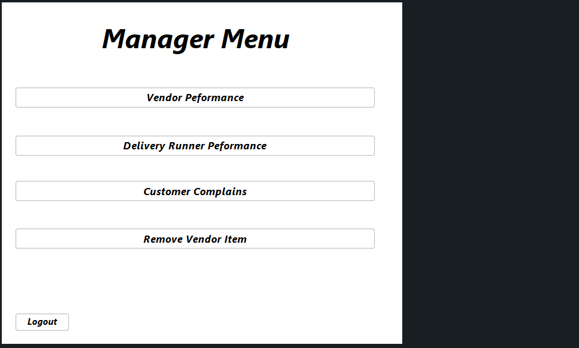

The manager dashboard provides access to **Vendor Performance**, **Delivery Runner Performance**, **Customer Complaints**, and **Remove Vendor Item**, with a logout action. Event handlers open the corresponding Swing windows and dispose of the previous form.

View manager class and navigation implementation evidence

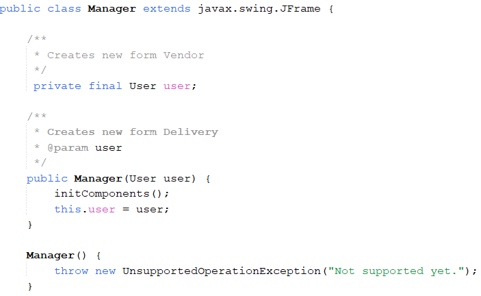

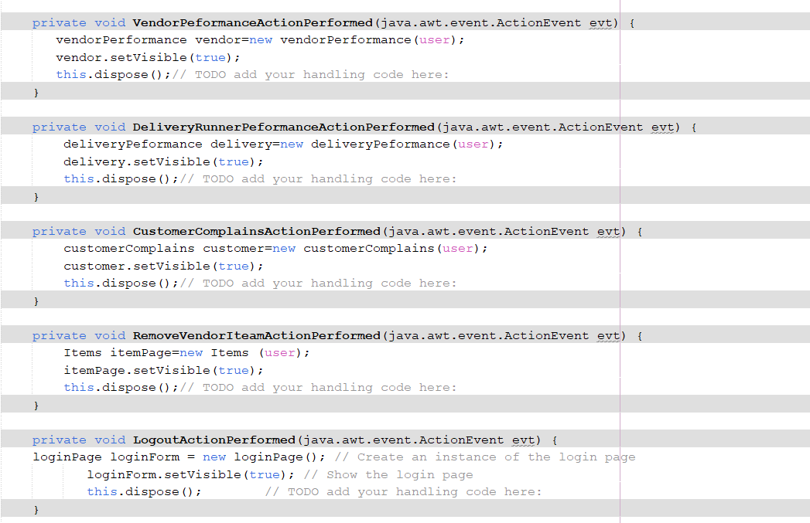

## 1. Vendor performance reporting

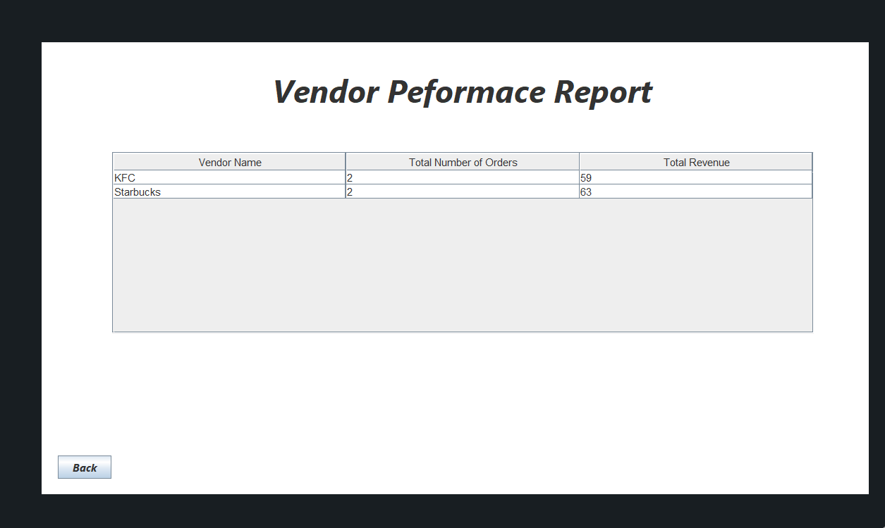

The report aggregates order counts and revenue per vendor. The documented `loadDataFromFile` method reads order records, groups them by vendor using a `HashMap`, and populates a `JTable` through its table model. Input-file reading errors are handled through a Swing dialog.

View vendor performance code evidence

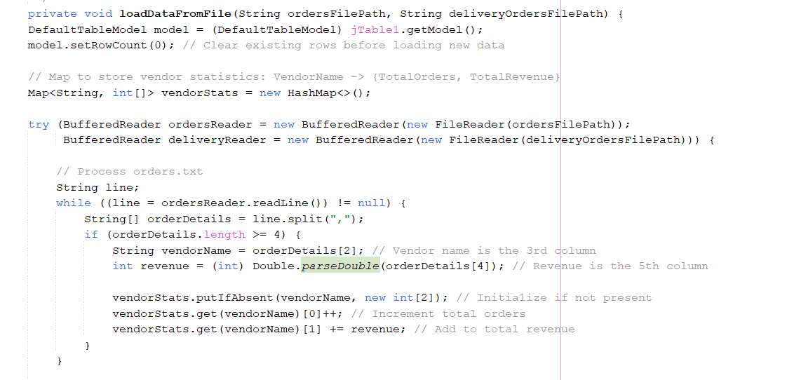

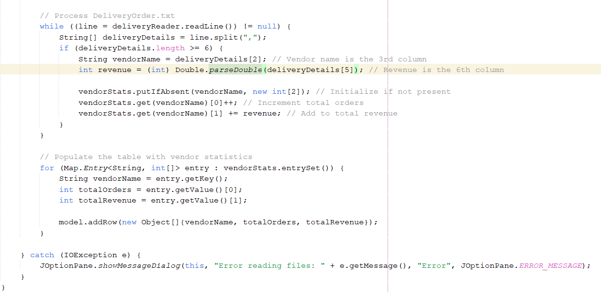

## 2. Delivery runner performance

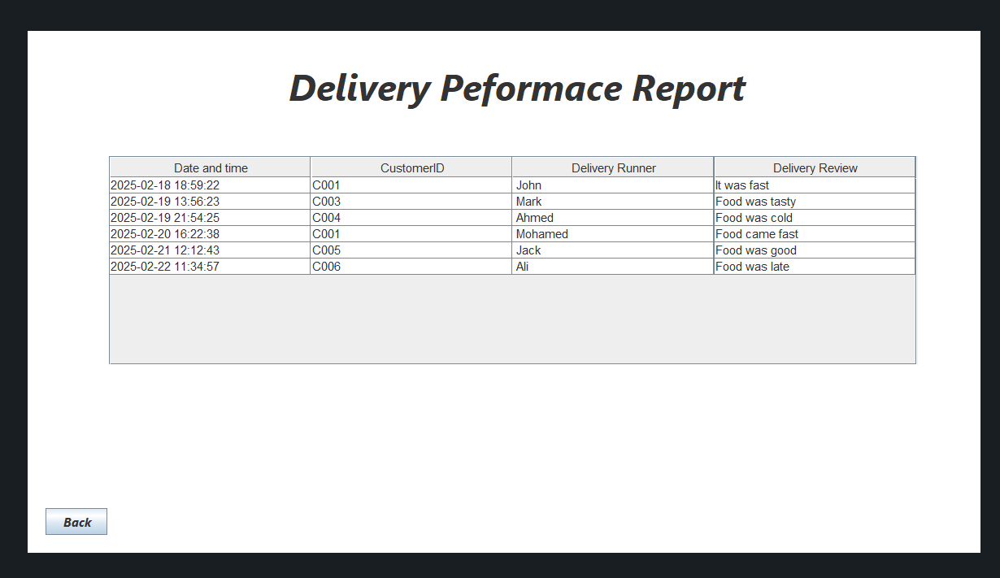

The delivery performance interface displays customer feedback associated with delivery activity, including date/time, delivery runner and review. The documented `loadTable` method parses `review.txt` and adds non-empty review records to a `JTable`.

View delivery report code evidence

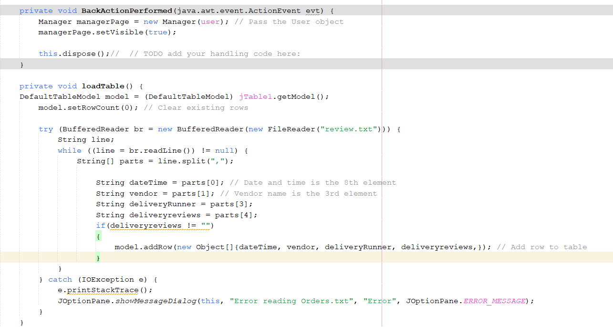

## 3. Customer complaint management

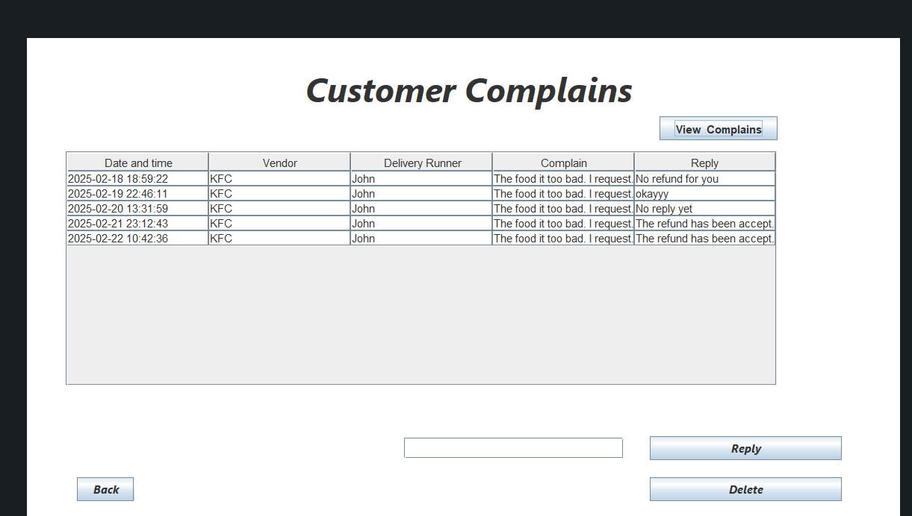

The complaints screen lets the manager **view**, **reply to**, and **delete** complaints. The documented implementation reads from `Complain.txt`, displays records in a table, and rewrites the file to persist replies or remove selected records. Feedback dialogs report operation results and errors.

View complaint-management code evidence

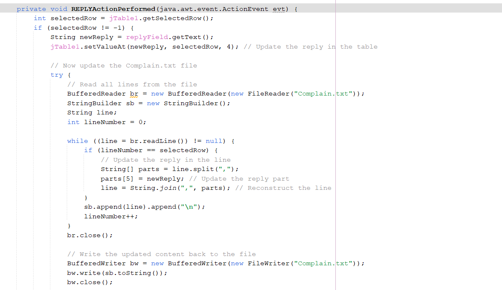

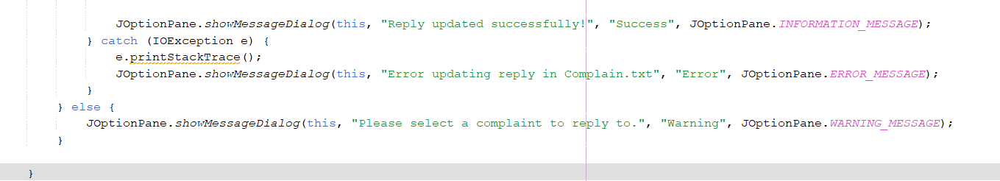

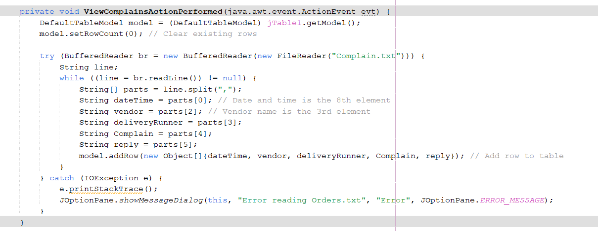

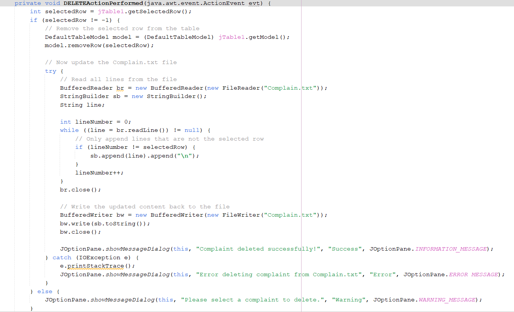

## 4. Vendor item management

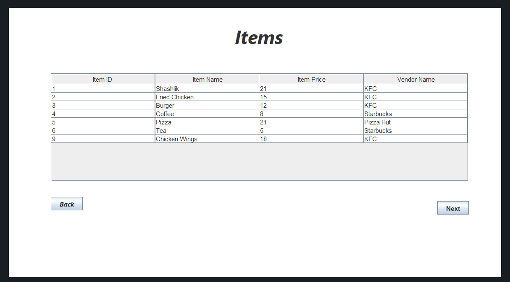

The item list displays item identifiers, names, prices and associated vendors. A separate deletion form accepts an item ID.

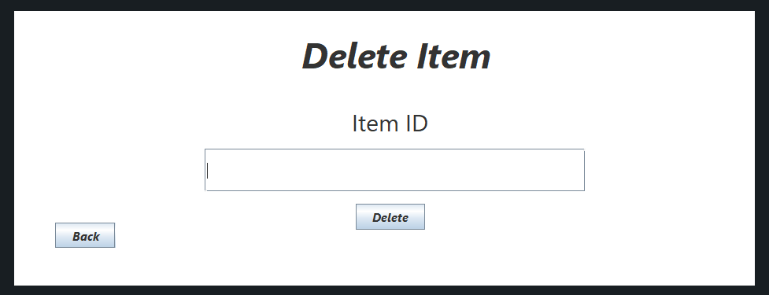

The documented deletion workflow validates the entered ID, reads `food_items.txt`, writes the retained records into `temp_food_items.txt`, and replaces the original file when an item is found. The interface displays success, missing-item, or error messages as appropriate.

View item-management code evidence

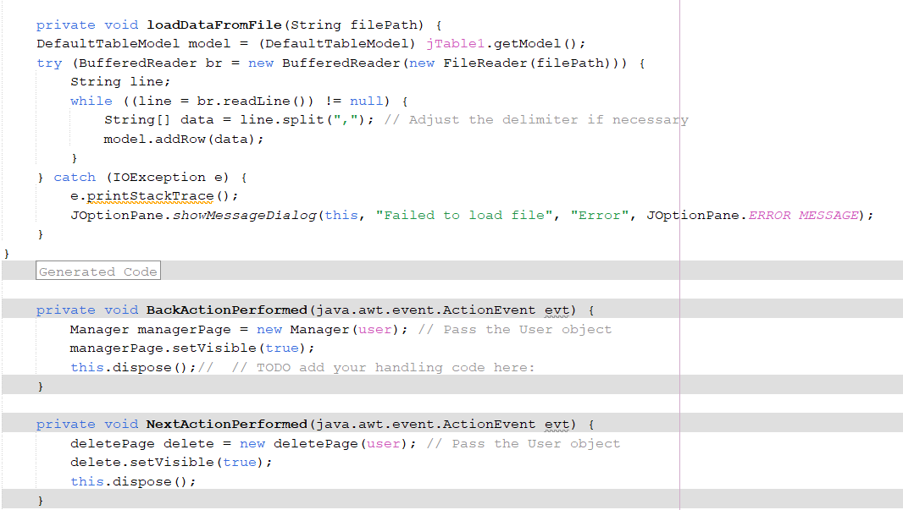

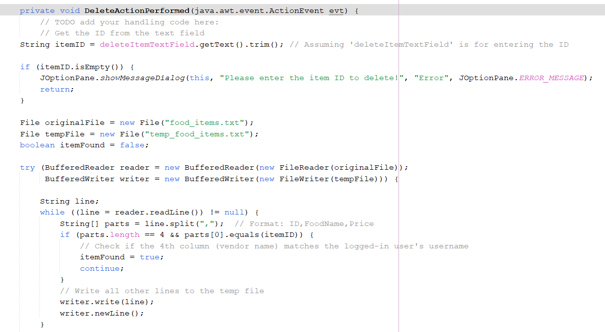

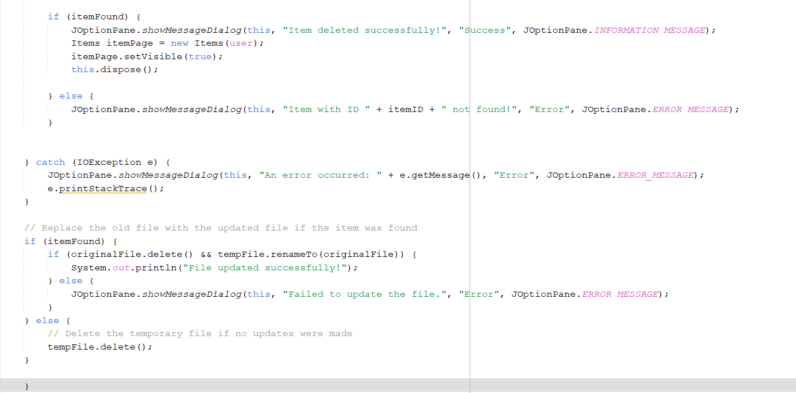

## Documented data flow

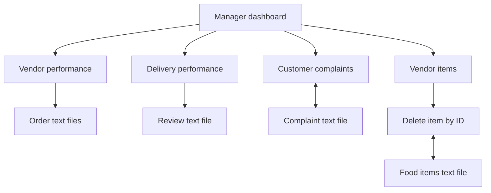

## Object-oriented concepts demonstrated

- **Inheritance:** the manager window extends `JFrame`.
- **Encapsulation:** the manager stores a private `User` reference; form-specific logic is kept in relevant classes.
- **Event-driven design:** Swing action handlers navigate between manager functions.
- **Abstraction:** UI actions invoke file-processing methods without exposing their implementation details to the user.
- **Data aggregation:** vendor totals are accumulated in a `HashMap` and presented through `JTable`.

## Evidence and documentation

All screenshots in this repository are extracted from the submitted **`JAVA DOCUMENTATION.docx`** and are linked from the same directory as this README so that GitHub displays them without extra folder setup.

The report provides evidence of the manager features and code snippets. It does **not** include a complete importable Java project, so there are no installation or execution instructions here. The report also describes other user roles at a high level, but their implementations are not demonstrated in the supplied document.

## Academic attribution

**Module:** Object-Oriented Development with Java (`CT038-3-2-OODJ`)  
**Institution:** Asia Pacific University of Technology & Innovation  
**Submission:** February 2025  
**Project type:** Group assignment  
**Team:** Fairouz Abdulrahman Hamed Mousa, Akmal Nasimboev, and Tasmay Shah

This is a **collaborative academic project**. The available documentation does not establish an individual division of programming responsibilities; therefore, the repository does not claim that any single team member implemented every feature.
